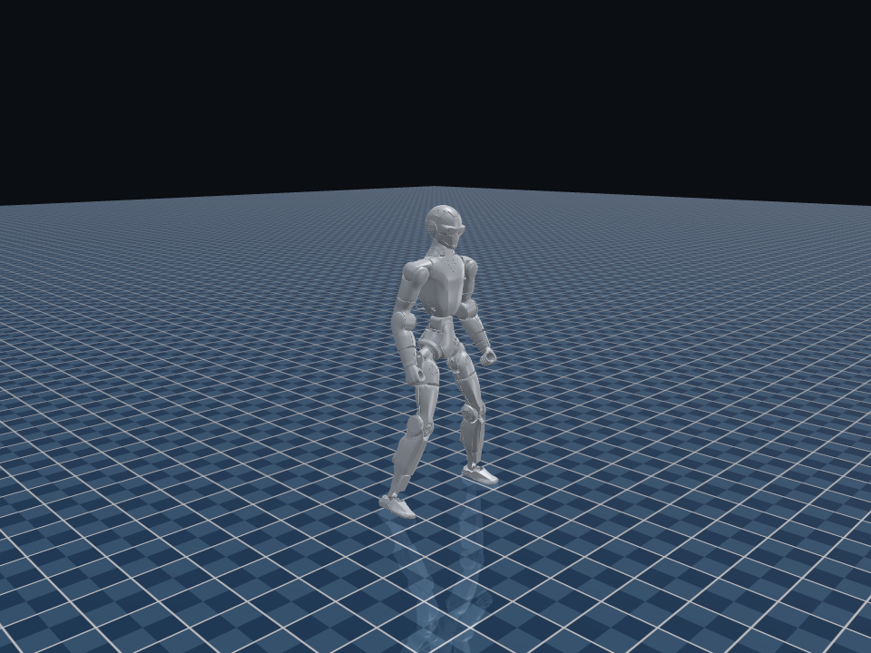
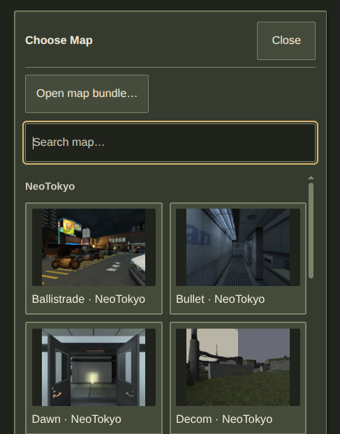
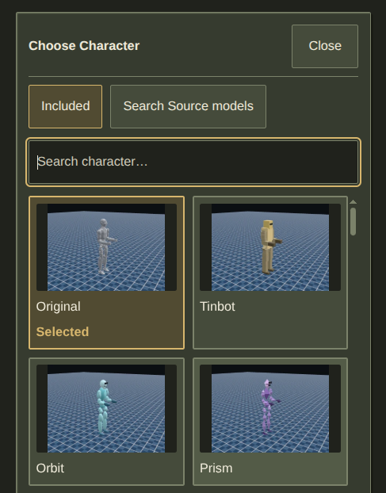
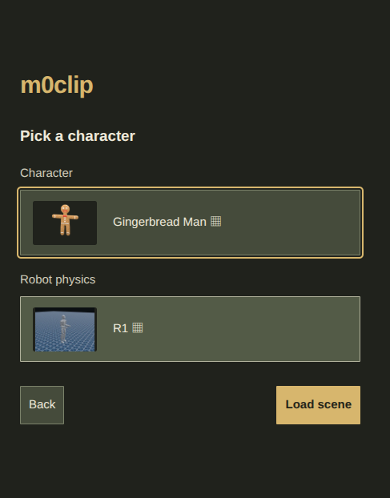

# m0clip

Drop Unitree robots and game characters into Source maps, walk them around and
record clips. It all runs in Chrome; the server only hosts files.

**[Try it at m0clip.com](https://m0clip.com)**



<sub>An R1 on the built-in Flat terrain, saved with the <b>Screenshot</b> button.</sub>

m0clip started from Konstantin Severov’s
[unitree-mujoco-web](https://github.com/legion1581/unitree-mujoco-web) and draws
Source maps with code from [noclip.website](https://github.com/magcius/noclip.website).
MuJoCo simulates the robot, Three.js renders the scene and ONNX Runtime Web runs
the walking policies.

## Make a clip

<p>
  
  
  
</p>

1. **Choose.** Pick a map (Ghost is the default) and a character, then press
   **Load scene**. The galleries show previews; models and policies download
   only after you load.
2. **Load.** The loader shows megabytes, the current step and, while files
   download, the time left. **Details** lists each file and any error. Press
   **Enter scene** when it finishes.
3. **Record.** Drive with W A S D and Q / E, or a gamepad. Press **N** to fly the
   camera instead. Press **V** to start recording and **V** again to stop.
   **? Help** lists every key.
4. **Export.** **Timeline** replays the take. From there, export video, a motion
   CSV or a GLB scene for Blender; **Camera / output** sets the camera, lens and
   format. **Screenshot** downloads a PNG and keeps a copy in **Shots**.

Takes, screenshots and imported policies stay in your browser for that site.
Download anything you want to keep before clearing site data.

### Play as a player

On the character step, choose **Player** to walk a map yourself instead of
driving a robot. Click the scene to capture the mouse; **Esc** releases it.

The physics gun starts equipped. Physics and spawn guns include original
first-person models and gloved hands; no game files are needed for these tools.

- **W A S D** move, **Shift** runs, **C** crouches, and **Space** or scrolling
  down jumps. Scrolling up selects the previous tool.
- Hold **X** for third person.
- **2** selects the physics gun. Hold the left button on a robot to pick it up;
  hold **Alt** and scroll to move it nearer or farther.
- **3** selects the spawn gun. Left-click places the robot chosen with **Q**;
  right-click removes the one under the crosshair. Only robots with an installed
  policy are offered.
- **V** records, and takes keep going when robots are added or removed.

Player mode needs a mouse and keyboard. **Add game content…** reads player models
from Source game files on your computer; the files are not uploaded.

<details>
<summary>More about scenes and takes</summary>

- **Backquote** hides or shows panels when the viewport is focused.
  **Tab** moves between controls.
- On narrow screens, **Play**, **Scene** and **Reference clip** share one
  Controls area; use the buttons above it to switch.
- **Reference clip** plays a motion CSV at the FPS you set. **Stop** hands control
  back to the selected policy. Some motions run once, then switch to their
  configured next policy; press **Run again** beside the finished line to replay
  that motion from where the robot stands.
- The policy gallery is grouped by activity. Each card names the motion and
  lists its robot variant, checkpoint and state number; search matches all three.
  In each group, policies that run on the robot's current body come first;
  choosing one of the others switches the body.
- While a gallery is open, the scene behind it holds its last frame; simulation
  and playback keep running. Recording and screenshots still draw every frame.
- In review, appearance, display, flashlight, lights and camera edits belong to
  that take. Robot, map and policy controls work only live. The **F** flashlight
  key is live-only; use its button while reviewing.
- Exports need an open recorded take. Starting a recording closes
  **Camera / output** and keeps its settings. Controls lock while encoding.
- **Details** in the loader lists each transfer. The total counts decoded scene
  files, including cache reads, not network traffic or memory. If loading takes
  more than 30 seconds, the progress bar turns into Pong.
- **Character wireframe** with **Map wireframe** off keeps the map solid. Keep
  **Textures** and **Map geometry** on to see the textured map.

</details>

## Build it yourself

You need Git, Node.js 22 or 24 with npm, Python 3.12+ with `venv`, and Chrome or
Chromium. Blender is optional, for converting characters.

**The repository is not the demo’s asset collection.** It includes the R1, G1 and
Go2 robots. Maps, character models and policy weights are not in Git; bring
files you are allowed to use and, if you host a build, redistribute.

Before `npm run dev` or `npm run build`, place a permitted
`public/assets/source/flashlight.png`, even if you only use built-in terrain. The
map importer extracts it when the asset mount contains
`materials/effects/flashlight001.vtf`.

Character metadata is optional. [`src/characters/catalog.ts`](src/characters/catalog.ts)
picks up the JSON in `public/assets/characters/` when Vite starts or builds;
characters without it are left out and the built-in choices remain. The Wrapped
and Skeleton need both `attribution.json` and `rig.json`; the PSX collection uses
its `catalog.json`.

Without a compatible policy pack the robot still simulates, but it has no learned
walking controller. A character changes appearance, not control.

```sh
git clone https://github.com/gadmaj/m0clip.git
cd m0clip
npm ci
python3 -m venv .venv
.venv/bin/python -m pip install numpy==2.4.6 Pillow==12.3.0 PyYAML==6.0.3

npm run dev
```

Open the URL Vite prints in Chrome. Don’t open `index.html` from disk: the
simulator needs the isolation headers the dev server sends. `npm ci` also copies
the MuJoCo JavaScript and WASM runtime into `public/wasm/`; if you skip install
scripts, run `node scripts/copy-ort-wasm.mjs` yourself.

To build and preview a static release:

```sh
npm run typecheck
PYTHON="$PWD/.venv/bin/python" npm run build
npm run preview
```

On a non-POSIX shell, set `PYTHON` to the virtual environment’s Python first.
The build writes `dist/`, compresses robot meshes, processes map visuals when
their inputs are present, and finally writes a startup asset catalogue from the
final file sizes. Keep everything in `dist/`, including `.gz` files.

<details>
<summary>Changing assets after a build</summary>

If you change files in a built `dist/`, regenerate its catalogue before serving:

```sh
node scripts/build_startup_catalogue.mjs dist
```

Prepare previews and model conversions before this pass, and don’t mix a
catalogue from one build with files from another. Map, character and robot
conversion records are left out of builds; keep them with your source assets.

</details>

<details>
<summary>Browser-check artifacts</summary>

Checks using `scripts/test-artifacts.cjs` create a private output directory for
each invocation. Set `QA_ARTIFACT_DIR` to choose its parent. Explicit `QA_OUTPUT`
and `MAP_CHECK_OUTPUT` destinations still apply to their respective checks.

`test_source_body_recording.cjs` reports its downloaded GLB as `exportedGlb`.
Pass that exact path to the texture check, which requires Pillow:

```sh
SOURCE_DOG_EXPORT="/path/from/exportedGlb" .venv/bin/python scripts/test_source_dog_export_pixels.py
```

Check complete local Source conversion with generated BSP, GMA and ZIP fixtures
(no game files required):

```sh
node scripts/test_source_raw_assembly.mjs
```

</details>

## Host it

Serve `dist/` at the root of an HTTPS origin (subdirectories need code changes)
with these headers:

```http
Cross-Origin-Opener-Policy: same-origin
Cross-Origin-Embedder-Policy: require-corp
```

MuJoCo needs them for `SharedArrayBuffer`. Don’t switch isolation off to get
past a blocked cross-origin asset; serve it from the same origin or with proper
CORS. [`deploy/home/`](deploy/home/README.md) has a ready Docker and Caddy setup.
`npm run preview` is for local testing only.

<details>
<summary>File types and caching</summary>

| Files | Serve as |
| --- | --- |
| JavaScript modules and workers | A JavaScript MIME type, at their generated paths. |
| `.wasm` | `application/wasm`, bytes unchanged. |
| `.json` manifests | `application/json`. A missing file must 404, not fall back to HTML. |
| GLB, ONNX, meshes, ZIPs | The original binary files with a binary MIME type. |
| Explicit `.gz` mesh and lightstyle files | `application/gzip` **without** `Content-Encoding`; the app inflates them itself. |

Ordinary HTTP compression is fine if the body really is encoded as declared.
Deploy HTML, scripts, manifests and their files together, and keep root files
such as `favicon.ico` beside `index.html`. Don’t cache `index.html` or mutable
manifests for long; use long-lived caching only for content-hashed URLs.

</details>

## Add your own assets

Only add assets you may use. Permission to download a file is not permission to
host it: Vite copies everything in `public/` into the build.

<details>
<summary>Source maps</summary>

In the map gallery, choose **Open local map…**, then **Source BSP**, **Source
GMA** or **Source ZIP**. Pick a map from the file. Use **Add archives…** for
ZIP, GMA or VPK companions, or **Add game folder…** for loose files.
The BSP’s embedded pak takes precedence, followed by the map archive, then
companions in their listed order. Files stay local; no game files are downloaded.

Missing or unsupported features stop conversion and appear under
**Requirements**, without replacing the current scene. A shared cause is listed
once; separate authored causes remain visible. Not every Source map is supported.

You can also convert a map on the command line for your own host:

```sh
.venv/bin/python scripts/import_source_bsp.py \
  --bsp asset-sources/map.bsp --name "My map"
```

This writes `public/assets/maps/<map-id>/` (the ID comes from the filename) and
adds the map to `public/assets/maps/index.json`. Input must be a `VBSP` map
without LZMA-compressed lumps. Materials and models the BSP doesn’t embed need a
compatible asset mount; `--game neotokyo --maps <map-id>` uses the importer’s
built-in NeoTokyo catalogue, not a general adapter for every Source game. See
[`import_source_bsp.py`](scripts/import_source_bsp.py) for arguments and mounts.
Not every prop, material or gameplay entity carries over.

The material converter multiplies `$color` by `$color2` and preserves `$alpha`
opacity. VMT colour vectors such as `{255 128 64}` use byte channels; `[1 .5 .25]`
uses normalized channels.
Unsupported tint ranges and alpha/mask combinations stop conversion instead of
changing authored values.

UV88 bump maps store signed X/Y channels. Source and Studio lighting reconstruct
their surface normals; GLB export converts them to standard RGB normal maps.
Neither path changes the stored native texture pixels.

</details>

<details>
<summary>Map bundles</summary>

Package a converted map so someone can open it without adding it to your host:

```sh
node scripts/package_map.mjs public/assets/maps/my_map \
  --output my_map.map.zip --name "My map" --game "Source"
```

The packager needs Linux (`/proc/self/fd`), rejects symlinks, checks the world,
prop, texture and physics dependencies, never overwrites an existing ZIP and
stays under 4 GiB. The bundle itself works in any browser.

In the map gallery, choose **Open local map… → Converted .map.zip**. The file is
checked locally in a worker and is not uploaded; cancel before installation to
keep the current scene. Local maps last for the tab’s session. Saved takes and
views remember the map, not its files, so reattach the original map and companions
after a reload. Finish loading a map or saved view before opening Timeline or
another take. VPKs supply companions; they are not a standalone map format here.

</details>

<details>
<summary>Characters</summary>

A character is a visual body on a supported robot’s physics, not a new
controller. It needs geometry, textures, attribution and a rig mapping; dropping
a GLB into `public/` does not register one.

[`import_character_assets.py`](scripts/import_character_assets.py) runs inside
Blender with a JSON `--config` (and optional `--source-root`). It reads Blender,
FBX and glTF sources and writes a GLB and preview. The config records source and
output paths, source hashes and attribution; public output requires an explicit
redistribution approval and license evidence. Register the result in
[`src/characters/catalog.ts`](src/characters/catalog.ts) yourself. Bipeds with
named left/right limbs align automatically; other skeletons may need an explicit
rig mapping.

**Search Source models** in the character gallery uses the
[pmodels index](https://github.com/wootguy/pmodels) and loads GoldSrc `IDST`
version 10 models only. Each model keeps its own authorship and terms; a search
result is not a license. Remote search depends on upstream services and CORS.

Galleries show still images and prebuilt turntable GIFs (PNG stills with reduced
motion) without loading models or weights. A turntable shows the rest pose, not
motion. Policy previews come only from captures of the exact robot and
checkpoint; without one, the gallery says it is showing the robot alone.

</details>

<details>
<summary>Policy packs</summary>

Import a compatible ZIP in **Controls → Play → Packs → Import .zip…**. Packs are
kept in the browser’s IndexedDB. A pack holds `pack.json`, its YAML config and
ONNX checkpoints, plus any extra networks or data its driver needs; a bundle is a
ZIP of pack ZIPs. The format is described in the
[policy-pack guide](policy-packs/README.md) and
[`src/packs/index.ts`](src/packs/index.ts). This is not a loader for arbitrary
neural networks.

To build a bundle from compatible local registry, YAML, ONNX and auxiliary files:

```sh
node scripts/build-packs.mjs --robot r1 --public . --out policy-packs/generated
```

`--public` is the input checkout root, not its `public/` folder. The command
writes `r1-all.zip` and individual packs, removes stale ZIPs from the output
folder, and can succeed with a partial set: read its warnings.

To host a default R1 or G1 catalogue, give it your own bundle for that robot
before building. Run it once per robot:

```sh
node scripts/host-default-packs.mjs asset-sources/r1-all.zip
node scripts/host-default-packs.mjs asset-sources/g1-all.zip
```

Each run writes `public/assets/packs/<robot>-default-v1.json` and the packs under
`public/assets/packs/<robot>/`. A browser fetches a catalogue only when its robot
is first selected, then downloads weights only for the policy you pick. Hosting
them distributes the weights, so check you are allowed to.

</details>

<details>
<summary>Gallery previews</summary>

For assets you may publish:

- [`generate-character-turntables.py`](scripts/generate-character-turntables.py)
  runs in Blender with a `--job` JSON: a new output directory, frame count and
  rate, and `characters` entries with `id`, `input`, `sha256`,
  `approvedRuntimeAsset` and `attribution`. It orbits each GLB’s rest pose and
  writes `turntable.gif` (lossy palette) and `still.min.png` (lossless).
- [`generate-policy-previews.cjs`](scripts/generate-policy-previews.cjs) records
  controller motion from your running build. Its JSON job supplies
  `approvedRuntimeAsset`, `robot`, `policy`, `pack`, `packSHA256`, `attribution`,
  `frames` and `fps`. It checks the robot, checkpoint and joints, and stops if
  the policy already finished, finishes during capture or the event history is
  full.

The policy helper needs Playwright, which `npm ci` does not install; install it
so Node can resolve it or set `PLAYWRIGHT_MODULE`. Set `CHROMIUM_PATH` if Chrome
is not at `/usr/bin/google-chrome`. Also set:

- `PREVIEW_CHROME_PROFILE`: absolute path to a dedicated Chrome profile, not your
  everyday one. Open it once, deal with any prompts, then quit Chrome.
- `PREVIEW_CHROME_VERSION`: the four-part version from
  `"${CHROMIUM_PATH:-/usr/bin/google-chrome}" --version`. Update it after a browser update.

The helpers refuse a busy profile or a different browser version and never
remove profile locks. They answer m0clip’s storage notice with **Not now**.

```sh
PYTHON="$PWD/.venv/bin/python" BASE_URL=http://localhost:4173 \
  PREVIEW_OUTPUT=/path/to/new-output \
  node scripts/generate-policy-previews.cjs /path/to/job.json
```

`PREVIEW_OUTPUT` must be a new directory outside `public/` whose parent exists.
To cap disk use, create a budget root, choose a new output inside it and set
`PREVIEW_BUDGET_ROOT`, `PREVIEW_BUDGET_BYTES` (retained files),
`PREVIEW_MIN_FREE_BYTES` (free-space floor) and `PREVIEW_RESERVE_BYTES` (room for
final files). The budget does not cover browser memory.

Keep generation records private. Publish only approved GIFs, stills and
attribution, and list them in
[`animated-preview-catalog.json`](src/ui/animated-preview-catalog.json).

</details>

## Limitations

- Detailed maps can take a large download, a lot of memory and a while to load.
- Source gameplay, moving doors, prop physics, particles and HDR bloom are not
  reproduced, and m0clip does not load every game noclip.website supports.
- Video export depends on the codecs your browser can encode.
- GLB exports use solid triangles, not wireframe lines, and skip Source’s
  shaders, lightmaps and tone mapping. **Textures** also controls the optional
  exported ground plane.
- Saved data belongs to one browser and hostname. It is not a cloud backup.
- Policies must match the robot model, observation/action scheme and driver.
  This is a simulator, not a safety controller for a real robot.
- Player mode moves like Garry’s Mod but does not run its game code. Authentic
  game-weapon models, knives and their animations are not available yet.

## Credits and licenses

- **Konstantin Severov**: the original
  [unitree-mujoco-web](https://github.com/legion1581/unitree-mujoco-web) simulator,
  including the R1, G1 and Go2 MuJoCo model bundles.
- **Unitree Robotics**: the R1, G1 and Go2 robots.
- **Jasper St. Pierre and noclip.website contributors**: Source formats and
  rendering; see [LICENSE.noclip](LICENSE.noclip).
- **MuJoCo, Three.js, ONNX Runtime and Mediabunny contributors**: physics,
  rendering, inference and media export.
- **Game, robot and character creators**: keep each asset’s notices and
  attribution when you build or redistribute. The screenshots show map previews
  from the NEOTOKYO° mod and
  [Rigged Gingerbread Man](https://opengameart.org/content/rigged-gingerbread-man)
  by Elegant Crow ([CC BY-SA 4.0](https://creativecommons.org/licenses/by-sa/4.0/)).

The code is under [LICENSE](LICENSE), with the separate noclip notice above.
Neither license covers game maps, robot assets, character models or policy
weights; check each one’s own terms before you redistribute it.
