# unitree-mujoco-web

Run Unitree RL control policies **entirely in the browser**. MuJoCo compiled to
WebAssembly runs the physics, onnxruntime-web runs the policies, and Three.js
renders the scene.

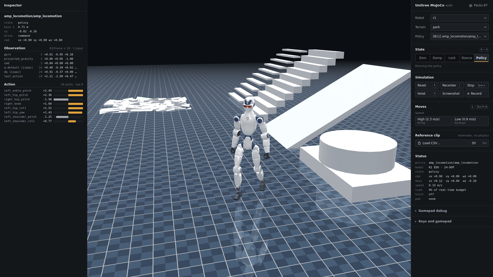

**Supported robots:** R1 (24 and 20 DOF), Go2, and G1 (29 and 23 DOF). Per-policy notes:
[G1](docs/G1_FIRMWARE_POLICIES.md) · [R1](docs/R1_FIRMWARE_POLICIES.md) · [Go2](docs/GO2_FIRMWARE_POLICIES.md).

## Gallery

Recorded in the browser app, flat terrain, hoist off, real time. The number is the FSM id the policy runs as on the robot.

### R1

<table>
<tr><td align="center" width="33%">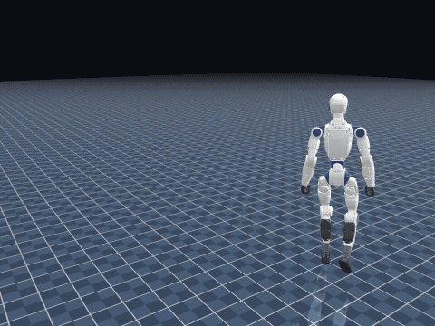<br><sub>Walk · 811 amp_locomotion</sub></td><td align="center" width="33%">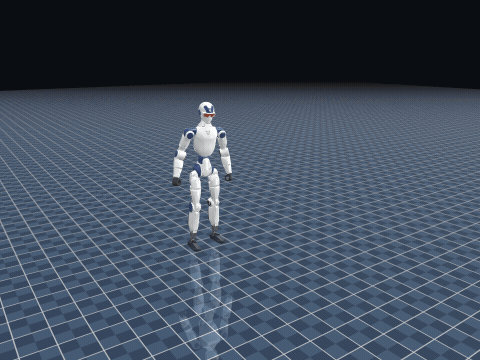<br><sub>Somersault · 804 actor (Take 125)</sub></td><td align="center" width="33%">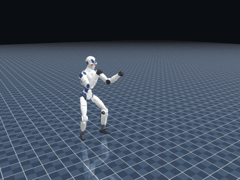<br><sub>Side kicks · 805 fight mode</sub></td></tr>
<tr><td align="center" width="33%">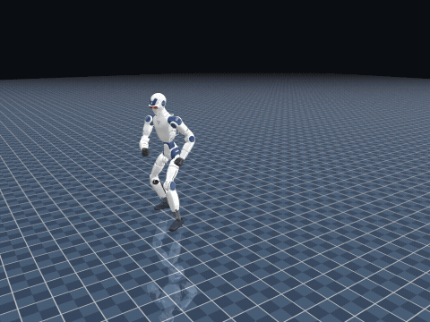<br><sub>Dance · 608 jiequandao</sub></td><td align="center" width="33%">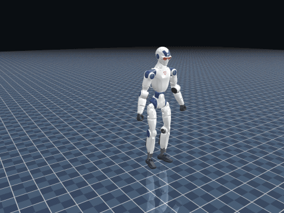<br><sub>Lie down and rise · qishen1 floor routine</sub></td><td align="center" width="33%">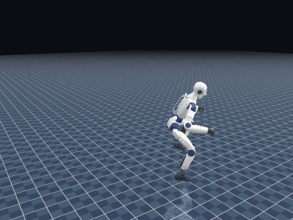<br><sub>Dance · 603 dance1 segment 3</sub></td></tr>
</table>

### Go2

<table>
<tr><td align="center" width="33%">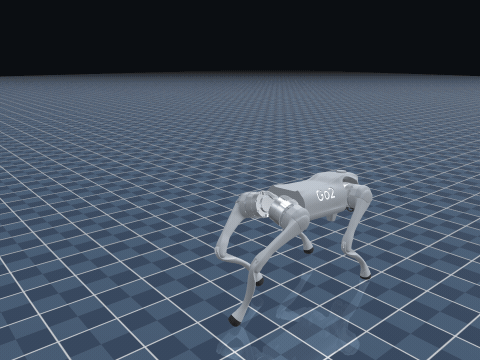<br><sub>Walk · 1003 FreeWalk</sub></td><td align="center" width="33%">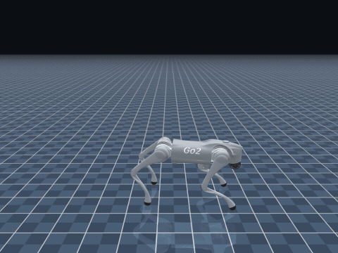<br><sub>Back flip · 2013</sub></td><td align="center" width="33%">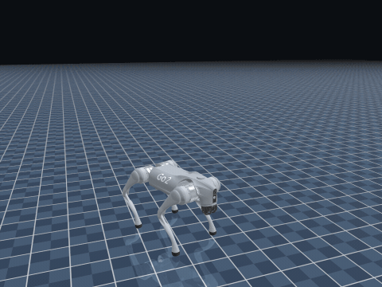<br><sub>Left flip · 2014</sub></td></tr>
<tr><td align="center" width="33%">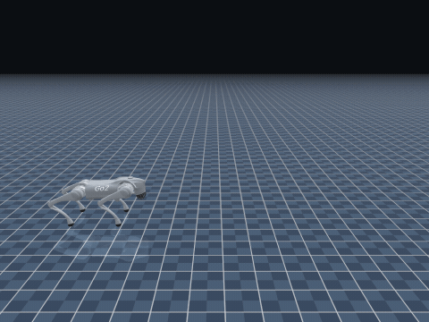<br><sub>Triple flip · ContinuousFlipX3</sub></td><td align="center" width="33%">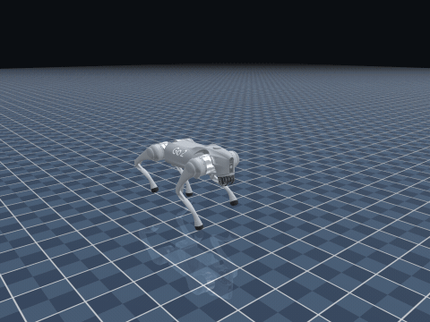<br><sub>Hand stand · 2011</sub></td><td align="center" width="33%">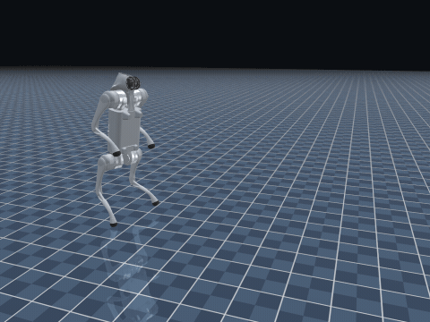<br><sub>Walk on hind legs · 2017 back stand</sub></td></tr>
</table>

### G1

<table>
<tr><td align="center" width="33%">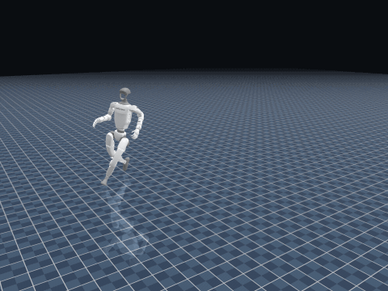<br><sub>Run · 802 CpyWalkRun (high speed)</sub></td><td align="center" width="33%">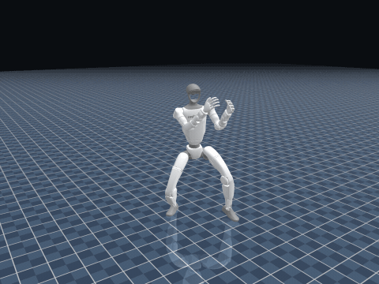<br><sub>Kicks · 505 punch mode</sub></td><td align="center" width="33%">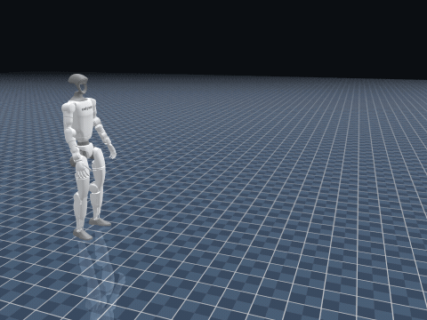<br><sub>Walk-jump leap · 813</sub></td></tr>
<tr><td align="center" width="33%">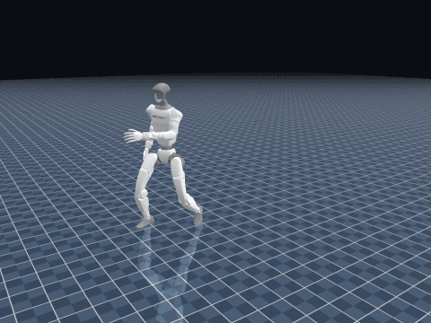<br><sub>Bruce Lee take · 503 human mimic</sub></td><td align="center" width="33%">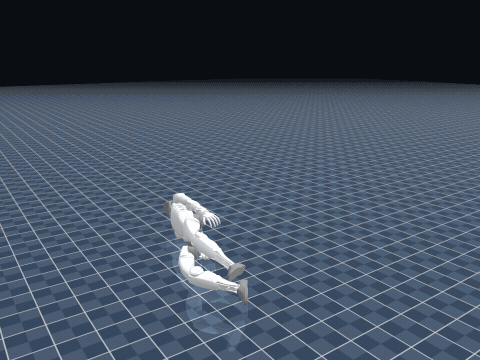<br><sub>Get up from the floor · 1001</sub></td><td align="center" width="33%">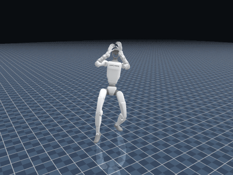<br><sub>Dance · 503 human mimic</sub></td></tr>
</table>

## Quick start

```bash
npm install     # also copies the mujoco wasm runtime into public/
npm run dev     # open the printed URL (Chrome recommended)
```

The robot models are included in the repo. The policies are not, so download
them separately:

1. Get the policy packs from <https://disk.yandex.com/d/TDS0JYh1GSjXow>
   (`g1-all.zip`, `r1-all.zip`, `go2-all.zip`, or individual packs).
2. In the app, open **Packs** (panel header) → **Import .zip…** and pick the files.

Imported policies are stored in your browser (IndexedDB) and survive reloads.
Pack format: [policy-packs/README.md](policy-packs/README.md).

## Features

- **Safety FSM** — ZeroTorque / Damping / Lock / Stance / Policy, like the on-robot controller.
- **Live policy switching** without reloading the page.
- **Gamepad and keyboard teleop**, including the robot remote's button combos.
- **Terrains** — flat, rough, slope, stairs, park.
- **Policy inspector** — live observations and action → joint targets.
- **Reference-clip playback** — preview a retargeted mocap CSV kinematically.
- **Capture** — screenshot (PNG) and recording (webm) of the viewport.

## Controls

| Input | Action |
|---|---|
| `0`–`4` | FSM state (ZeroTorque, Damping, Lock, Stance, Policy) |
| `[` / `]` | previous / next policy |
| `W A S D` / `Q E` | move: vx / yaw / vy (hold Shift for full speed) |
| `R` / `C` / `Space` | reset pose / recenter / stop |
| `H` | hoist on / off |
| `G` / `Shift+G` | next / previous move |
| left stick, right stick | vx+vy, yaw |
| LT+dpad-up, LT+B, LT+Y, LT+X | Stance, Damping, ZeroTorque, Lock |
| RT+A, RT+B, RT+dpad ◀▶ | Policy, reset, switch policy |
| LB / RB / LT / RT + buttons | the active policy's remote combos |

## Architecture

The whole simulation (MuJoCo, onnxruntime, drivers, FSM) runs in a **Web
Worker**, because MuJoCo's pthread-enabled wasm deadlocks on the main thread.
The main thread only renders and handles input. The two sides talk through
`src/sim/protocol.ts`.

```
src/
  worker/      sim worker: engine, FSM, drivers, control loop
  core/        math, onnx wrappers, per-robot policy drivers
  packs/       policy-pack parsing and IndexedDB store
  sim/         mujoco engine, FSM, terrain presets, protocol
  render/      Three.js scene
  input/       gamepad → commands
  robots/      per-robot specs
  ui/          control panel
public/assets/models/<robot>/   MJCF + meshes + manifest.json
```

## Notes

- A production build must be served with **COOP/COEP headers** (the mujoco wasm
  uses SharedArrayBuffer): `Cross-Origin-Opener-Policy: same-origin` and
  `Cross-Origin-Embedder-Policy: require-corp`. The dev and preview servers already set them.
- Browsers: current Chrome, Edge and Firefox. Safari 16.4+ is untested.
